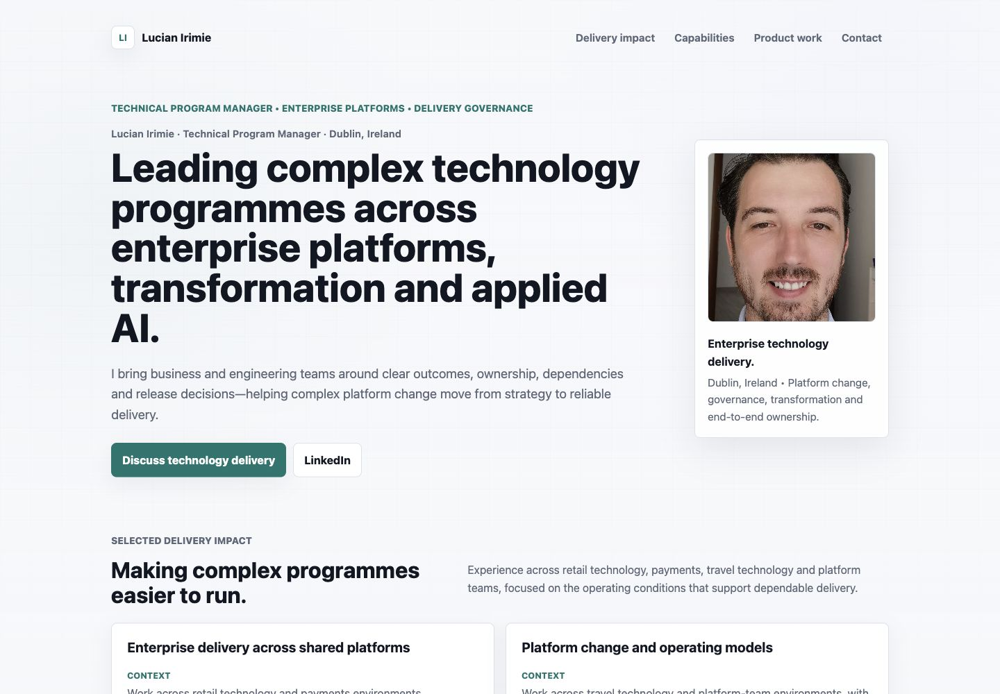
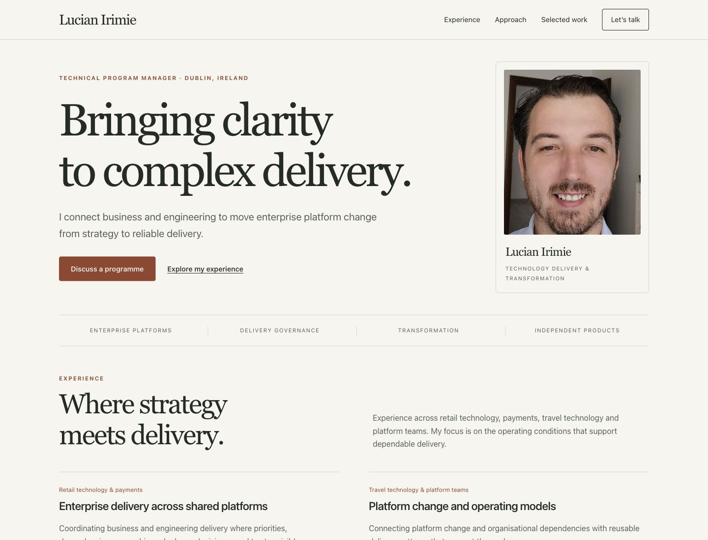

# Personal website redesign review

Review date: 21 October 2026. Branch: `feat/personal-brand-redesign`.

## Live audit

1. **Personal site, desktop — needs improvement.** The long hero repeats positioning and delays the next section. Repeated bordered cards flatten the distinction between professional experience and independent products. [Before](before-desktop.png).
2. **Personal site, mobile — navigation gap.** Primary navigation disappears below 680px. The hero, introductory profile and repeated cards make the page slow to scan. [Before](before-mobile.png).
3. **SynapseWorks, desktop — strong reference.** The live site uses a clear headline, restrained palette, readable spacing and immediate product shortcuts. Borrowed principles: hierarchy, concise introductions, consistent section rhythm and clear actions. Reference: <https://synapseworks.org/>.
4. **SynapseWorks, mobile — strong reference.** Navigation remains available, content reflows cleanly and primary actions stay legible. The personal site's redesign follows these responsive principles with a disclosure menu rather than hiding navigation.

The current live sites were opened and captured in the in-app browser at desktop and 390px mobile sizes. Findings above are based on those captures, not historical screenshots. Screenshots alone do not establish accessibility compliance.

## Design decisions

- Selected the first of three visual explorations using the user's delegated design authority: warm paper, dark olive ink, terracotta accents and Georgia display typography. This creates a personal editorial identity separate from SynapseWorks' commercial mint identity.
- Keep the static HTML/CSS stack. Shared CSS and a small deferred script replace the large inline stylesheet. System fonts avoid third-party font requests, font loading shifts and new dependencies. A single light palette provides a consistent presentation, with a dark contact section.
- Sequence the page as identity → experience → approach → independent products → current focus → contact. Retain existing section IDs (`impact`, `capabilities`, `products`, `focus`, `contact`) for incoming links.
- Preserve the real portrait, name, Technical Program Manager title, Dublin location, professional domains, existing delivery examples, email addresses and external destinations. No employers, career dates, financial figures, certifications, testimonials or performance metrics have been added. Link to the existing LinkedIn profile for full career history.
- Keep English for the site's existing international professional audience. Shorten and reorganise existing content without turning the site into a product catalogue.
- RME features were checked against the current source README. Remove the stale “current release v1.7.0” badge and sentence; the product destination remains the source for changing release details. Submit Guard wording follows its live product description and stays limited to form submissions on enabled sites.
- Keep the privacy policy's paragraphs and original policy date intact. Reuse the new header, footer and typography. Cookie choices invokes the existing Zaraz consent API when present; its normal link leads to the policy's cookies section when the API is absent. No analytics script or consent configuration was added or changed.
- Retain canonical production URLs, existing JSON-LD identity and sitemap routes; refresh title/description/social metadata and correct portrait dimensions to the actual 1337 × 2048 pixels.

## Validation

- `python3 tools/check_site.py --external`: passed. Both HTML documents, one H1/main per page, balanced tags, unique IDs, ARIA references, local assets and fragments, JSON-LD, canonical routes, XML sitemap and seven external HTTPS destinations checked. All seven returned HTTP 200.
- `node --check assets/site.js` and `git diff --check`: passed.
- Homepage and privacy page rendered at 320, 390, 768, 1024 and 1440 CSS pixels. No horizontal overflow or offscreen elements at those widths. 320px actions stack; larger mobile actions fit in a row; desktop navigation remains visible.
- Browser interactions: mobile menu opens/closes, `aria-expanded` follows state, Escape closes and restores toggle focus, Enter/Tab access the menu links, and choosing a section closes the menu. The next Tab continues within the chosen section. The skip link moves keyboard focus to the main landmark. Primary email destinations and all product/profile links retain their real targets.
- Cookie fallback opens `/privacy/#cookies`; privacy navigation returns to homepage sections. Browser console checked with no warnings or errors recorded.
- Computed foreground/background checks on 64 homepage text samples: lowest ratio 5.51:1. This is a text-contrast sample, not a full WCAG certification.
- Critical homepage source payload (HTML + CSS + JS + unchanged portrait) is approximately 215 KiB uncompressed, excluding favicon. No framework, external fonts, new tracking, package install or runtime service. No field Core Web Vitals or throttled network performance claims are made.
- This repository has no application build or pre-existing test runner. Direct static serving plus the validator and browser checks exercise the deployment inputs. GitHub Pages' hosted Jekyll build is not run locally.

## Visual QA

Compared the selected concept and implementation together at the same desktop viewport. The first pass showed a different hero line break and excessive space before experience. The second pass fixed the deliberate headline wrapping, hero spacing, portrait frame height and experience heading rhythm.

Final result: passed. Typography, spacing, palette, real portrait, copy, mobile composition and primary interactions reviewed. Deliberate adaptations: native system/Georgia fonts; a text secondary action; the original ungenerated portrait; real experience details in place of conceptual “Explore this work” links. No remaining P0/P1/P2 findings in the reviewed states.

Remaining limits: in-app browser only; no separate Android/iOS hardware or additional browser engines, no full assistive-technology audit, no test of Cloudflare-managed consent injection on this local origin. Reduced-motion CSS and navigation without JavaScript were inspected in source, not separately emulated. The existing Cloudflare consent dialog is outside this repository's presentation controls.

## Preview and publication boundary

Run `python3 -m http.server 4187 --bind 127.0.0.1` from the repository and open <http://127.0.0.1:4187/>. The local preview does not include Cloudflare's injected analytics/consent configuration.

GitHub Pages was inspected before pushing: source branch `main`, path `/`, legacy Pages build. Push only the feature branch and create a draft PR. Do not merge, push `main`, change Pages settings, modify DNS or invoke a production deployment. The local preview and draft PR are the review surfaces; no public preview hosting was provisioned.

### Before / after

Desktop:

Mobile:

